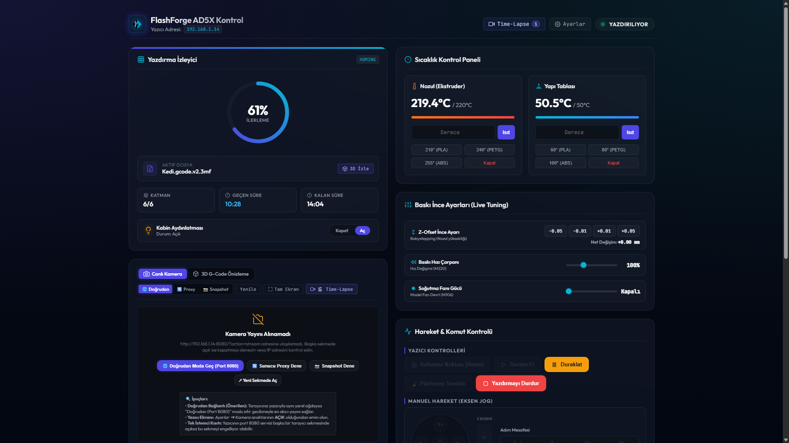

# FlashForge AD5X Web Dashboard & Home Assistant Entegrasyonu

<p align="center">
  
</p>

<p align="center">
  <strong>FlashForge AD5X (Adventurer 5M / 5M Pro)</strong> 3D yazıcıları için modern, responsive <strong>Web Kontrol Paneli (Web Dashboard)</strong> ve tam donanımlı <strong>Home Assistant Özel Bileşeni (Custom Component)</strong>.
</p>

<p align="center">
  
</p>

---

Yazıcının **TCP kontrol portu (8899)**, **HTTP detay/sensör portu (8898)** ve **MJPEG kamera portu (8080)** protokolleri çözümlenerek; durum izleme, canlı kamera yayını, donanım sensörleri, IFS filament yönetimi, makro kontroller ve baskı sırasındaki canlı ince ayarlar (Live Tuning) tek bir çatı altında birleştirilmiştir.

---

## 📂 Proje Yapısı

```text
flashforge/
├── hFlashForgeLogo.svg          # Vektörel SVG uygulama ve marka logosu
├── hFlashForgeLogo.png          # PNG formatında uygulama simgesi / favicon
├── screenshot.png               # Web Dashboard arayüz ekran görüntüsü
├── flashforge_panel.py          # FastAPI tabanlı Web Sunucu (Backend), Kamera Proxy & Time-Lapse Motoru
├── config.json                  # Yazıcı bağlantı ve kalıcı ince ayarlar (Otomatik oluşturulur)
├── requirements.txt             # Python paket bağımlılıkları listesi
├── start.sh                     # Linux & Raspberry Pi otomatik sanal ortam ve başlatıcı scripti
├── flashforge.service           # systemd arka plan servis yapılandırma dosyası
├── .gitignore                   # Git önbellek ve kullanıcı yapılandırması yoksayma kuralları
├── templates/
│   └── dashboard.html           # Modern, responsive ve premium Web Arayüzü (Frontend)
├── custom_components/
│   └── flashforge_ad5x/         # Home Assistant özel entegrasyonu
│       ├── __init__.py          # Entegrasyon başlangıç ve koordinatör yapılandırması
│       ├── api.py               # HA için asenkron FlashForge API istemcisi (HTTP + TCP)
│       ├── const.py             # Sabitler (Domain, scan interval vb.)
│       ├── config_flow.py       # HA arayüzünden kurulum ve bağlantı akışı
│       ├── manifest.json        # HA entegrasyon meta verileri ve bağımlılıkları
│       ├── sensor.py            # Sıcaklıklar, katman, ilerleme, hata teşhis, TVOC ve donanım sensörleri
│       ├── light.py             # Kabin aydınlatma kontrolü (HTTP ve TCP tabanlı)
│       ├── button.py            # Platform Temizle (setClearPlatform), Home, Duraklat, Devam, Reset (M999/M602)
│       ├── camera.py            # Canlı MJPEG kamera ve anlık görüntü yakalama entegrasyonu
│       └── strings.json         # Türkçe/İngilizce dil ve çeviri tanımları
├── homeassistant_guide.md       # Home Assistant detaylı kurulum, Lovelace kartları ve sorun giderme rehberi
└── README.md                    # Kapsamlı proje dokümantasyonu
```

---

## ⚙️ Temel Özellikler ve Çalışma Mantığı

### 1. 📷 3 Farklı Canlı Kamera Akış Modu (Camera Streaming)
Yazıcının dâhili `mjpg-streamer` kamera servisi donanımsal olarak tek bağlantı sınırı (single-client limit) içerebilir. Panel, her türlü ağ koşuluna uyum sağlayacak 3 farklı mod sunar:
* **🌐 Doğrudan Mod (Port 8080) [Varsayılan]:** Tarayıcınız yerel ağdayken doğrudan `http://<YAZICI_IP>:8080/?action=stream` adresine bağlanır. Sunucuya 0% yük bindirir, sıfır gecikmeyle (native 30fps) kristal netliğinde yayın verir.
* **🔄 Sunucu Proxy Modu (`/api/camera/stream`):** Dış ağdan, VPN veya Reverse Proxy arkasından erişen kullanıcılar için yayını `CameraBroadcasterThread` motoru üzerinden proxy'ler ve birden fazla istemciye aynı anda dağıtır.
* **📸 Snapshot Modu (`/api/camera/snapshot`):** Düşük bant genişliği veya stabil olmayan bağlantılarda saniyede 1 kare (1 fps) anlık fotoğraf çeker.
* **Tam Ekran Desteği:** Kamera akışını tek tıkla tam ekran moduna alabilirsiniz.

---

### 2. 🧊 3D G-Code Önizleme ve Canlı Baskı Görselleştirici (WebGL / Three.js)
Mevcut görsel izleme kartı içerisine entegre edilen modern 3D görselleştirici ile baskılarınızı yazdırmadan önce veya yazdırılırken gerçek zamanlı inceleyebilirsiniz:
* **📐 FlashForge AD5X 3D Tablası:** 220 × 220 × 220 mm yapı hacmi, milimetrik koordinat ızgarası ve orijin (0,0) eksenleri.
* **🌈 Dinamik Katman Renklendirmesi:** Katman yüksekliğine göre HSL renk geçişli (Cyan ➔ İndigo ➔ Menekşe ➔ Amber) ekstrüzyon çizgileri ve açılıp kapatılabilen yarı saydam boşta hareket (travel) hatları.
* **🎮 360° Serbest Kamera & Hazır Açılar:** Fare ile serbest döndürme (Orbit), kaydırma (Pan), yakınlaştırma (Zoom) ve tek tıkla İzometrik (3D), Üst (Top), Ön (Front) bakış açıları veya modeli ortalama.
* **🎚️ Katman Kaydırıcı (Layer Slider) & Animasyon:** 1. katmandan son katmana kadar kaydırma, katman adım butonları (◀ / ▶) ve otomatik katman katman yazdırma simülasyonu (▶ Oynat).
* **🔴 Canlı Yazıcı Katman Senkronizasyonu:** Yazıcı aktif baskı yaparken gelen katman verisiyle (`M27` katman telemetrisi) otomatik eşzamanlanarak nozulun ulaştığı yüksekliği canlı gösterir.
* **📁 Dosya Desteği & Sürükle-Bırak:** Bilgisayarınızdan herhangi bir `.gcode` veya `.3mf` dosyasını doğrudan ekrana sürükleyip bırakabilir, LAN yükleme kutusundan seçebilir veya dahili 20mm kalibrasyon test küpünü tek tıkla yükleyebilirsiniz.
* **💾 Sunucu Önbelleği (G-Code Cache):** Web paneli üzerinden yazıcıya gönderilen G-Code ve 3MF dosyaları otomatik önbelleğe alınarak aktif baskı başladığında tek tıkla 3D ekrana aktarılır.
* **⛶ Tam Ekran Modu:** Tek tıkla tüm ekranı kaplayan sinematik 3D modelleme alanı.

---

### 3. 🛠️ Sistem & Servis Yönetimi (Settings Modal)
Web arayüzünün sağ üstündeki **⚙️ Ayarlar** penceresi ve **Uçbirim (G-Code Konsolu)** üzerinden kritik operasyonlar tek tıkla yürütülür:
* **🔄 Servisleri Yeniden Başlat (`/api/service/restart`):** Panel arka plan sorgulayıcısını (`watch_loop`), soket havuzunu ve kamera yayıncısını temizleyip baştan başlatır.
* **📷 Kamerayı Sıfırla (`/api/camera/restart`):** Askıda kalan kamera istemci soketlerini kapatır ve yeni bağlantı açar.
* **🔓 Oturumu Serbest Bırak (`/api/printer/unlock` - `~M602`):** FlashForge yazıcısı kilitli bir oturumda takılı kaldığında soket kilidini açar.
* **⚠️ Yazıcıyı Yeniden Başlat (`/api/printer/restart` - `~M999`):** Yazıcı anakartına ve firmware'ine yeniden başlatma sinyali gönderir.

---

### 4. 🎛️ Canlı İnce Ayar (Live Tuning) & Otomatik Sıfırlama
* **Babystepping (Z-Ofset):** Baskı sırasında tablanın ilk katman mesafesini `0.01 mm`, `0.05 mm` veya `0.10 mm` adımlarla canlı olarak ayarlama. `SET_GCODE_OFFSET` ve `M290` komutları ardışık gönderilerek hem Klipper hem Marlin uyumluluğu sağlanır.
* **Baskı Hızı Çarpanı (Feedrate):** `%5` hassasiyetli sürgü ile `M220 S{yüzde}` komutu gönderimi.
* **Kabin Soğutma Fanı:** `%` sürgü değeriyle `M106 S{değer}` komutu üzerinden anlık fan devri ayarı.
* **Baskı Bitiminde Otomatik Sıfırlama:** Baskı tamamlandığında veya iptal edildiğinde (`READY` moduna geçildiğinde); Z-Ofset `0.00 mm`, Hız `%100` ve Fan `%0` değerlerine otomatik olarak çekilir.

---

### 5. 🧵 Etkileşimli IFS (Filament İstasyonu) Yönetimi
* AD5X / Adventurer 5M Pro 4-slotlu Filament İstasyonu durumunu (Slot rengi, malzeme tipi, yüklü slot) görselleştirir.
* Arayüzdeki slot kartına tıklandığında onay istenerek yazıcıya otomatik `T0`, `T1`, `T2`, `T3` filament değiştirme komutu gönderilir.
* "Filamenti Çıkar" butonuyla aktif slot serbest bırakılabilir.

---

### 6. 📊 Zengin Donanım & Sensör Telemetrisi (HTTP 8898 /detail API)
* **⏱️ Canlı Geçen Süre ve Kalan Süre Sayacı:** Baskı başladığı andan itibaren net süreyi (`X sa Y dk Z sn`) hesaplayan dinamik geçen süre sayacı ve tahmini bitişe kalan süre telemetrisi eşzamanlı olarak gösterilir.
* **Kabin & Hazne Sıcaklığı:** Anlık ve hedef nozul, yatak ve kabin sıcaklık takibi.
* **TVOC Hava Kalitesi:** Hazne içi VOC gazı seviyesi (`ppb`).
* **Fan Hızları:** Sol Fan, Sağ/Ana Soğutma Fanı ve Hazne Fanı devirleri (`%`).
* **Kapı & LED Durumu:** Kapı açık/kapalı algılayıcısı ve kabin aydınlatma durumu.
* **İstatistikler:** Kalan dahili disk alanı (`GB`), Toplam çalışma süresi (`saat`), Toplam tüketilen filament (`metre`), Nozul modeli.

---

### 7. ⚠️ Akıllı Duraklatma, Hata Teşhis & Çok Katmanlı Platform Temizleme (Smart Pause & Clear Platform)
Yazıcı baskı esnasında duraklatıldığında veya arıza moduna geçtiğinde (`MachineStatus: PAUSED / ERROR`):
* **🔍 Çok Katmanlı Teşhis Algoritması:** Yazıcının neden durduğunu otomatik tespit eder (Kapak açık sensörü `doorStatus == open`, filament bitti/eksik `filamentLack`, M119 sensör bayrakları `F:1`/`J:1`, donanım hata kodları `errorCode` veya katman duraklatması).
* **🚨 Yüksek Görünürlüklü Uyarı Paneli:** Sayfanın en üstünde turuncu/kırmızı parlayan teşhis bildirimi açılır ve doğrudan üzerinde **"▶ Devam Et"** ile **"⏹ İptal Et"** butonları sunar.
* **🔔 Sıfır Bağımlı Sesli İkaz (Web Audio API):** Duraklatma ve hata anında tarayıcıda sentetik çift tonlu melodi çalarak uzaktayken bile anında haber verir.
* **📱 Masaüstü Tarayıcı Bildirimleri:** Tarayıcı arka plandayken dahi masaüstü bildirimi (Desktop Notification) gönderir.
* **💡 Parlayan "Devam Et" Butonu:** Duraklatma anında "Devam Et" butonu nabız gibi parlayarak kullanıcının aksiyon almasını kolaylaştırır.
* **🧊 3D Önizleme Senkronizasyonu:** 3D G-Code panelindeki canlı bilgi şeridinde de duraklatma gerekçesi ve hata mesajı gerçek zamanlı yansıtılır.
* **🎉 Baskı Tamamlandı & Uzaktan Çok Yönlü Platform Temizleme:** Önceki baskı bittiğinde FlashForge yazıcılarının ekranında beliren *"Yazdırma tamamlandı, platformu temizleyin!"* modal penceresi ve `BUILDING_COMPLETED` durumu otomatik algılanır. Sayfa tepesinde parlayan turkuaz ikaz paneli açılır, zafer fanfarı çalar ve tek tıkla **"🧹 Platformu Temizle"** butonuna basıldığında tersine mühendislik ile çözülmüş `setClearPlatform`, `cleanPlate`, `clearError`, `reset` JSON komutları ve TCP `~M26` komut zinciri yazıcıya iletilerek **fiziksel yazıcı ekranına gitmeye gerek kalmadan** uyarı uzaktan kapatılır ve yazıcı anında `READY` durumuna geçer.
* **🛡️ Otomatik İyileştirmeli G-Code Gönderimi (Broken Pipe Koruması):** Platform temizlenmeden yeni bir G-Code gönderilmeye çalışıldığında yazıcının bağlantıyı koparması (`[Errno 32] Broken pipe`) otomatik yakalanır; arka planda platform temizleme komutu iletilip yükleme otomatik yinelenerek baskı kesintisiz başlatılır.

---

### 8. 🖨️ Çoklu Malzeme / Çok Renkli Baskı & IFS Eşleme ("Plakayı Yazdır" Penceresi)
Flash Studio masaüstü uygulamasındaki gibi, yazdırma başlatılmadan önce açılan modern modal ile gelişmiş baskı konfigürasyonu:
* **🎨 Otomatik Model Analizi (`/api/model/parse`):** Seçilen `.3mf` veya `.gcode` dosyasının XML filament etiketleri, dilimleyici başlık/kuyruk konfigürasyonları taranarak modelde kullanılan tüm Tool numaraları (`T0`, `T1`...), malzeme türleri (PLA, PETG vb.) ve HEX renk kodları otomatik olarak ayrıştırılır.
* **🔄 Akıllı Renk Mesafesi Algoritması:** Modeldeki her renk, yazıcının 4'lü IFS istasyonunda takılı olan filamentlerin renkleriyle Delta-E Öklid renk mesafesi algoritması üzerinden karşılaştırılır ve en yakın renk eşleşmesi otomatik seçilir.
* **🎛️ Esnek Slot Seçimi ve Renk Ekleme:** Kullanıcı dilerse arayüzdeki açılır kutudan istediği IFS slotunu (`Slot 1` - `Slot 4`) veya harici makarayı seçebilir, dilerse **"➕ Renk Ekle"** butonuyla yeni filament kanalları tanımlayabilir.
* **Baskı Öncesi Tercihleri:** Yatak seviyeleme (`levelingBeforePrint`), IFS istasyonunu devreye alma (`useMatlStation`) ve Time-Lapse video kaydı (`timeLapseVideo`) onay kutuları üzerinden bağımsız olarak kontrol edilir.

---

### 9. ⚡ İki Aşamalı Baskı Başlatma, Akıllı eMMC Retry & Tersine Mühendislik Protokolü (Dual-Stage Print Dispatch)
Flash Studio Desktop (`FlashNetwork.dll`) ve FlashForge AD5X firmware haberleşmesi derinlemesine tersine mühendislik ile çözümlenmiştir:
* **Aşama 1 - Güvenli Dosya Yükleme (`POST http://{IP}:8898/uploadGcode`):** `multipart/form-data` formatında dosya yazıcının dahili flash hafızasına kaydedilir. Dosya yazımı esnasında çakışmaları ve asılı kalmaları önlemek için `printNow: 0` bayrağı ile atomik olarak kaydedilir.
* **Aşama 2 - Akıllı eMMC Eşitleme & Retry Motoru (`POST http://{IP}:8898/printGcode`):** Büyük dosyalarda Linux/Android tabanlı yazıcı eMMC belleğinin diske yazım (flush) gecikmesi nedeniyle dönebilen *"Printer is Busy"* yanıtına karşı, 6 denemeli (her adımda 2.0 saniye beklemeli) akıllı tekrar algoritması devreye girer.
* **Otomatik Platform Kurtarma:** 2. denemede yazıcı hâlâ meşgulse, arka planda platform kilitlenme durumunu sıfırlamak için `_clear_platform_sync` komutu otomatik tetiklenir.
* **🛡️ Çok Aşamalı TCP Fallback:** HTTP servisinin yanıt vermediği veya kilitlendiği durumlarda TCP Port 8899 üzerinden `~M23 0:/user/{fileName}` ve `~M24` çiftli komut zinciri otomatik devreye girerek baskının kesin olarak başlamasını sağlar.
* **▶️ Yazıcıdaki Dosyayı Tek Tıkla Başlatma (`can_start_stored`):** Eğer dosya başarıyla yüklenmiş fakat yazıcı o anda meşgul olduğu için baskı başlatılamamışsa, kullanıcıya tekrar yükleme beklemeden modal penceresinden tek tıkla **"▶️ Yazıcıdaki Dosyayı Başlat"** ve **"🧹 Platformu Temizle"** aksiyonları sunulur.
* **JSON Baskı Başlatma Şeması:**
  ```json
  {
    "serialNumber": "SNMQQF9301246",
    "checkCode": "dd89422a",
    "fileName": "model_plate_1.3mf",
    "levelingBeforePrint": true,
    "flowCalibration": false,
    "firstLayerInspection": false,
    "timeLapseVideo": true,
    "useMatlStation": true,
    "gcodeToolCnt": 2,
    "materialMappings": [
      {
        "toolId": 0,
        "slotId": 3,
        "materialName": "PLA",
        "toolMaterialColor": "#FFFFFF",
        "slotMaterialColor": "#FFFFFF"
      }
    ]
  }
  ```

---

### 10. 📁 Yazıcı Hafızasındaki Dosyalar & Doğrudan Baskı Başlatma ("Yazıcıdaki Dosyalar" Modal)
Yazıcının dahili flash belleğinde kayıtlı tüm modelleri yönetmek için tam teşekküllü arayüz ve API:
* **📋 Dahili Dosya Listesi (`GET /api/printer/files`):** Yazıcının `POST http://{IP}:8898/gcodeList` servisi sorgulanarak hafızadaki tüm `.3mf` ve `.gcode` dosyaları listelenir.
* **📊 Zengin Baskı Detayları:** Her dosya için yazıcının kendi hesapladığı toplam filament ağırlığı (`gram`), tahmini baskı süresi (`saat / dakika`), kullanılan tool sayısı ve renk rozetleri gösterilir.
* **🚀 Tek Tıkla Yeniden Yazdırma (`POST /api/print/start`):** Önceden gönderilmiş veya yazıcı hafızasında bulunan bir dosyayı bilgisayarınızdan tekrar yüklemekle vakit kaybetmeden doğrudan **"Baskıyı Başlat"** butonuna basarak anında üretime alabilirsiniz.

---

### 11. 🎬 Otomatik Time-Lapse Video Kayıt, Galeri ve Katman Oynatıcısı (Automated Time-Lapse System)
Baskılarınızın hızlandırılmış sinematik kayıtlarını hiçbir harici donanım veya OctoPrint eklentisine ihtiyaç duymadan oluşturur:
* **📸 Katman Senkronize Kare Yakalama (`TimeLapseManager`):** `M27` katman telemetrisi dinlenerek her yeni katmana geçildiğinde kamera akışından otomatik olarak yüksek çözünürlüklü JPEG kare yakalanır. Katmansız veya vazo modundaki baskılarda ise akıllı zamanlayıcı devreye girer.
* **🎞️ Çoklu Format Derleme (MP4 & WebP):** Baskı tamamlandığında sistemde `ffmpeg` mevcutsa H.264 MP4 video; kurulu değilse PIL (Pillow) motoruyla sıfır harici bağımlılıkla yüksek kaliteli hareketli **WebP Time-Lapse** videosu otomatik olarak derlenir.
* **🔄 Kesinti ve Oturum Kurtarma:** Panel veya servis yeniden başlatılsa bile yarım kalan kare dizinleri taranır, geçerli kareler kurtarılır ve kullanıcı galerisine otomatik eklenir.
* **🎚️ Katman Katman İnteraktif İnceleme (Scrubber Player):** Tarayıcı üzerinden katman kaydırma çubuğu ile baskının istediğiniz anına gidebilir, katman katman nozul hareketini geri veya ileri sarabilirsiniz.
* **📥 İndirme ve Yönetim API'leri:**
  * `GET /api/timelapse/list` ➔ Kayıtlı oturumlar ve aktif baskı kare sayısı.
  * `GET /api/timelapse/video/{session_id}` ➔ Video akışı veya doğrudan indirme (`?download=true`).
  * `GET /api/timelapse/thumbnail/{session_id}` ➔ Oturum kapak fotoğrafı.
  * `GET /api/timelapse/frames/{session_id}` ➔ Katman kareleri dizisi.
  * `DELETE /api/timelapse/{session_id}` ➔ Eski kayıtları silme.

---

### 12. 🏠 Home Assistant Entegrasyonu
Bileşen Home Assistant içerisinde tam teşekküllü bir cihaz olarak tanımlanır:
* **Sensörler (`sensor`):** Nozul, Yatak, Hazne sıcaklıkları, Katman, İlerleme, Baskı durumu, **Duraklatma / Hata Nedeni**, TVOC hava kalitesi, 4 adet IFS slot durumları, Kalan disk alanı vb.
* **Aydınlatma (`light`):** Kasa LED ışığını açıp kapatma.
* **Kamera (`camera`):** `camera.flashforge_ad5x_kamera` varlığı ile doğrudan Lovelace kartlarında canlı MJPEG yayın ve anlık önizleme.
* **Kontrol Butonları (`button`):** **Platformu Temizle / Sıfırla (setClearPlatform)**, Home, Duraklat, Devam, Acil Durdurma, Oturumu Sıfırla (M602), Yazıcıyı Yeniden Başlat (M999).

---

## 🚀 Kurulum ve Çalıştırma

### A. Web Dashboard

#### 1. Yöntem: Otomatik Başlatıcı (Önerilen - Linux & Raspberry Pi)
Depoyu klonladıktan veya güncelledikten sonra tek bir komutla sanal ortamı otomatik kurup paneli başlatabilirsiniz:
```bash
chmod +x start.sh
./start.sh
```
*(Farklı bir port kullanmak isterseniz: `PORT=9003 ./start.sh`)*

#### 2. Yöntem: Manuel Sanal Ortam (VENV - Debian 12 / Raspberry Pi OS Uyumlu)
Debian 12 ve Raspberry Pi OS (Bookworm) üzerinde PEP 668 gereği sanal ortam oluşturarak çalıştırma:
```bash
# Gerekli sistem paketini kurun (kurulu değilse):
sudo apt update && sudo apt install -y python3-venv python3-full

# Sanal ortamı oluşturun ve bağımlılıkları yükleyin:
python3 -m venv venv
./venv/bin/pip install --upgrade pip
./venv/bin/pip install -r requirements.txt

# Paneli başlatın:
./venv/bin/python -m uvicorn flashforge_panel:app --host 0.0.0.0 --port 9003
```

#### 3. Yöntem: Doğrudan Kurulum (--break-system-packages)
```bash
pip install --break-system-packages -r requirements.txt
python3 -m uvicorn flashforge_panel:app --host 0.0.0.0 --port 9003
```

#### 4. Yöntem: systemd Servisi Olarak Arka Planda Kalıcı Çalıştırma (Raspberry Pi & Linux)
Cihaz her açıldığında panelin otomatik olarak arka planda çalışmasını sağlamak için depodaki `flashforge.service` dosyasını kullanabilirsiniz:
```bash
# 1. Servis dosyasını systemd dizinine kopyalayın:
sudo cp flashforge.service /etc/systemd/system/

# 2. systemd daemon'unu yeniden yükleyin:
sudo systemctl daemon-reload

# 3. Servisi başlangıçta otomatik çalışacak şekilde etkinleştirin ve başlatın:
sudo systemctl enable --now flashforge.service

# Servis durumunu ve loglarını kontrol etmek için:
sudo systemctl status flashforge.service
```
*(Not: Kullanıcı adınız veya proje dizininiz farklıysa `sudo nano /etc/systemd/system/flashforge.service` ile `User` ve `WorkingDirectory` alanlarını düzenleyebilirsiniz).*

#### Erişim ve İlk Ayarlar:
* Tarayıcınızdan `http://<RASPBERRY_PI_IP>:9003` adresini açın.
* Sağ üstteki **⚙️ Ayarlar** butonuna tıklayarak Yazıcı IP adresinizi ve LAN Kodunuzu (Check Code) girip kaydedin.

---

### B. Home Assistant

1. Projedeki `custom_components/flashforge_ad5x` klasörünü Home Assistant'ın `/config/custom_components/` dizini altına kopyalayın.
2. Home Assistant'ı yeniden başlatın.
3. **Ayarlar ➔ Cihazlar ve Hizmetler ➔ Entegrasyon Ekle** bölümünden **FlashForge AD5X** entegrasyonunu seçin ve IP adresinizi girerek kurulumu tamamlayın.
4. Detaylı Lovelace panelleri ve kart örnekleri için [`homeassistant_guide.md`](homeassistant_guide.md) kılavuzunu inceleyebilirsiniz.

---

## 🌐 REST API Uç Noktaları Referansı

Web Dashboard backend'i (FastAPI), harici otomasyonlar ve üçüncü taraf istemciler için zengin bir REST API sunar:

| Uç Nokta (Endpoint) | Metot | Açıklama |
| :--- | :--- | :--- |
| `/api/status` | `GET` | Anlık durum, sıcaklıklar, katman, fanlar, kapak, IFS slotları ve donanım telemetrisi |
| `/api/command` | `POST` | G-Code komutu iletme (`pause`, `resume`, `stop`, `home`, `led_on`, `led_off`, `custom`) |
| `/api/clear_platform` | `POST` | Önceki baskı tamamlandı modalını uzaktan temizleme (`setClearPlatform`) |
| `/api/model/parse` | `POST` | 3MF veya G-Code dosyasından filament tool'ları, renkleri ve IFS eşlemelerini analiz etme |
| `/api/upload` | `POST` | G-Code/3MF dosyasını yazıcıya yükleme, IFS slot eşlemeleriyle baskıyı başlatma |
| `/api/printer/files` | `GET` | Yazıcının dahili flash hafızasındaki kayıtlı dosyaları, gramaj ve süreleri listeleme |
| `/api/print/start` | `POST` | Yazıcı hafızasındaki bir dosyayı doğrudan yazdırmaya başlatma |
| `/api/timelapse/list` | `GET` | Kayıtlı time-lapse oturumları ve aktif kayıt durumunu listeleme |
| `/api/timelapse/video/{id}` | `GET` | Derlenmiş MP4 / WebP time-lapse videosunu izleme veya indirme (`?download=true`) |
| `/api/timelapse/frames/{id}` | `GET` | İnteraktif scrubber için katman kareleri URL listesi |
| `/api/camera/stream` | `GET` | Çoklu istemci destekli MJPEG kamera proxy yayını |
| `/api/camera/snapshot` | `GET` | Tek kare anlık kamera görüntüsü (JPEG) |
| `/api/settings` | `GET / POST` | Sunucu IP, Port, Seri No ve LAN kodu yapılandırması |
| `/api/service/restart` | `POST` | Panel arka plan servislerini ve kamera yayıncısını yeniden başlatma |
| `/api/printer/unlock` | `POST` | Askıda kalan TCP kontrol oturumunu serbest bırakma (`~M602`) |
| `/api/printer/restart` | `POST` | Yazıcı anakartını yeniden başlatma (`~M999`) |

---

## 📜 Desteklenen G-Kod ve Komut Referansı

| İşlem | Komut | Açıklama |
| :--- | :--- | :--- |
| **Login (Kontrol Al)** | `~M601 S1` | TCP port 8899 üzerinde oturum açar |
| **Logout (Serbest Bırak)** | `~M602` | Kilitli oturumu serbest bırakır |
| **Reboot (Yeniden Başlat)** | `~M999` / `~FIRMWARE_RESTART` | Anakart ve firmware yeniden başlatma |
| **Home (Sıfırlama)** | `~G28` | Tüm eksenleri referans konumuna gönderir |
| **Baskı Duraklat** | `~M25` | Devam eden baskıyı duraklatır |
| **Baskı Devam** | `~M24` | Duraklatılan baskıyı sürdürür |
| **Baskı İptal / Durdur** | `~M26` | Baskıyı sonlandırır |
| **Z-Ofset Ayarla** | `SET_GCODE_OFFSET Z_ADJUST={val} MOVE=1` + `M290 Z{val}` | Babystepping mikron düzeyinde Z ayarı |
| **Baskı Hızı Çarpanı** | `~M220 S{yüzde}` | Hızı dinamik olarak ayarlar (örn: `S120`) |
| **Fan Devri** | `~M106 S{0-255}` | Soğutma fanı gücünü ayarlar |
| **Kasa Işığı (LED)** | `~M146 r255 g255 b255 f0` / `~M146 r0 g0 b0 f0` | LED aç / kapat |
| **IFS Slot Seçimi** | `~T0`, `~T1`, `~T2`, `~T3` | İlgili filamente otomatik geçiş |

---

## 👨‍💻 Geliştirici & Hakkında (About & Author)

Bu proje, **Mustafa Özkaya ([hOLOlu](https://git.mustafaozkaya.tr/hololu))** tarafından **FlashForge Adventurer 5M / 5M Pro / AD5X** serisi 3D yazıcılar için modern, bağımsız, yüksek performanslı bir Web Kontrol Paneli ve Home Assistant entegrasyonu sunmak amacıyla geliştirilmiştir.

* **Geliştirici:** Mustafa Özkaya ([@hOLOlu](https://git.mustafaozkaya.tr/hololu))
* **Kaynak Kod Deposu:** [https://git.mustafaozkaya.tr/hololu/FlashForgeAD5X](https://git.mustafaozkaya.tr/hololu/FlashForgeAD5X)
* **Desteklenen Cihazlar:** FlashForge Adventurer 5M (AD5M), FlashForge Adventurer 5M Pro (AD5M Pro), FlashForge AD5X ve 4-Slot IFS Filament İstasyonu Modülü.

---

## 📄 Lisans & Telif Hakkı (License & Copyright)

Bu proje **MIT Lisansı** kapsamında açık kaynak olarak lisanslanmıştır.

```text
MIT License

Copyright (c) 2026 Mustafa Özkaya (hOLOlu)

Permission is hereby granted, free of charge, to any person obtaining a copy
of this software and associated documentation files (the "Software"), to deal
in the Software without restriction, including without limitation the rights
to use, copy, modify, merge, publish, distribute, sublicense, and/or sell
copies of the Software, and to permit persons to whom the Software is
furnished to do so, subject to the following conditions:

The above copyright notice and this permission notice shall be included in all
copies or substantial portions of the Software.

THE SOFTWARE IS PROVIDED "AS IS", WITHOUT WARRANTY OF ANY KIND, EXPRESS OR
IMPLIED, INCLUDING BUT NOT LIMITED TO THE WARRANTIES OF MERCHANTABILITY,
FITNESS FOR A PARTICULAR PURPOSE AND NONINFRINGEMENT. IN NO EVENT SHALL THE
AUTHORS OR COPYRIGHT HOLDERS BE LIABLE FOR ANY CLAIM, DAMAGES OR OTHER
LIABILITY, WHETHER IN AN ACTION OF CONTRACT, TORT OR OTHERWISE, ARISING FROM,
OUT OF OR IN CONNECTION WITH THE SOFTWARE OR THE USE OR OTHER DEALINGS IN THE
SOFTWARE.
```
